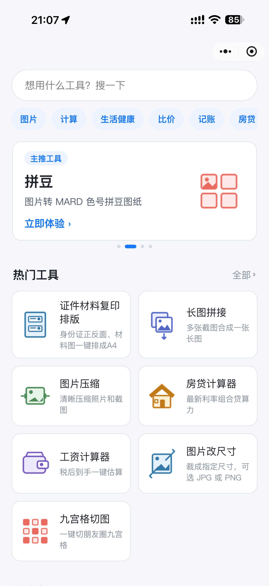
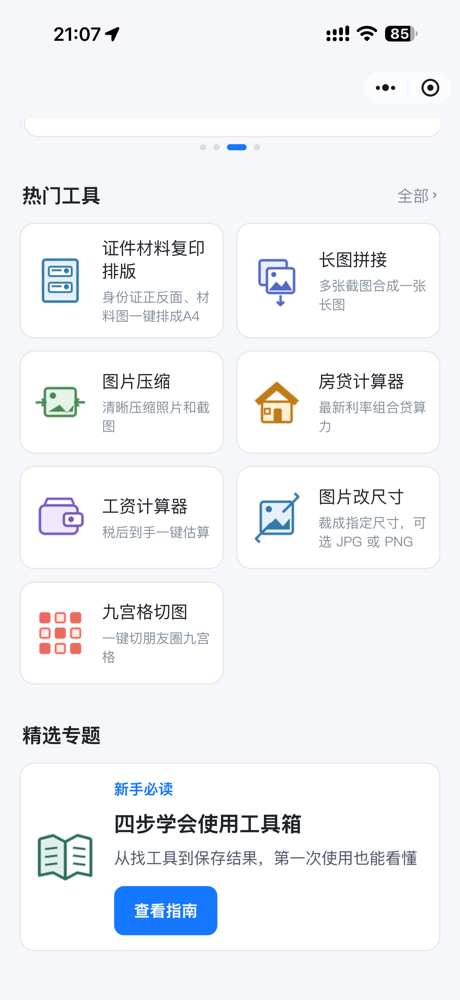
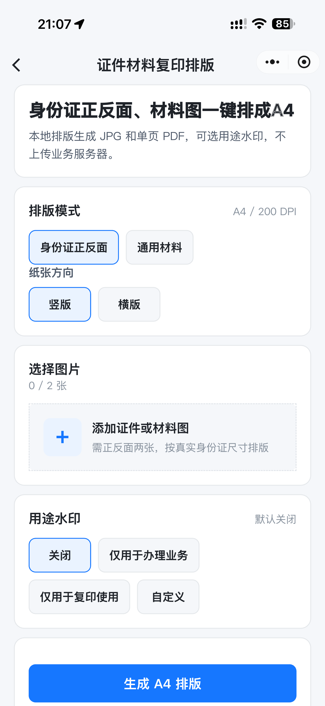
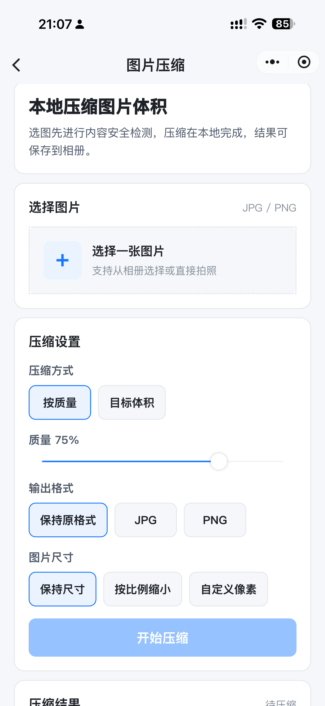
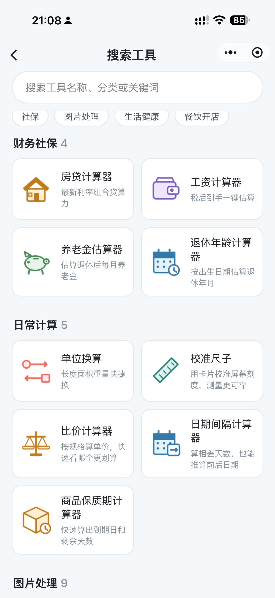
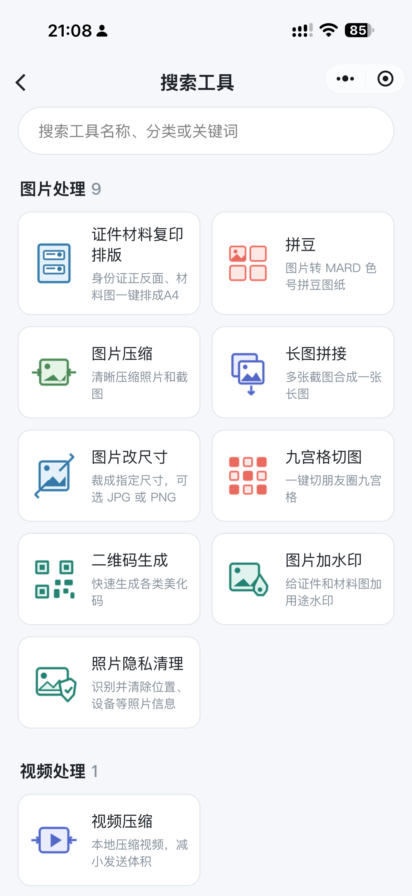
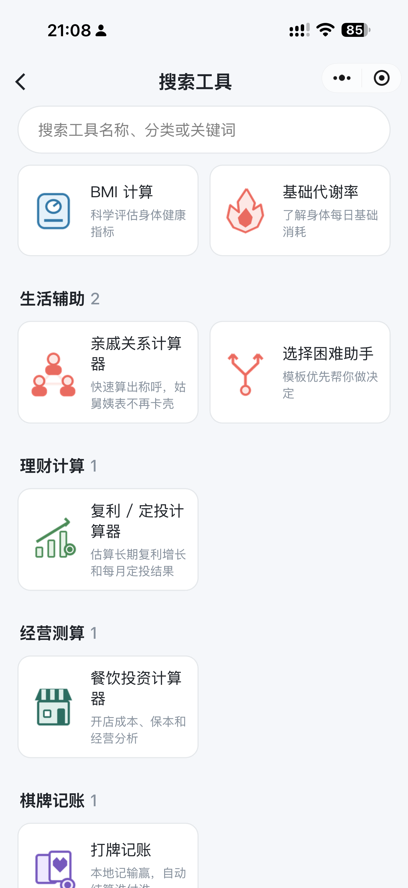
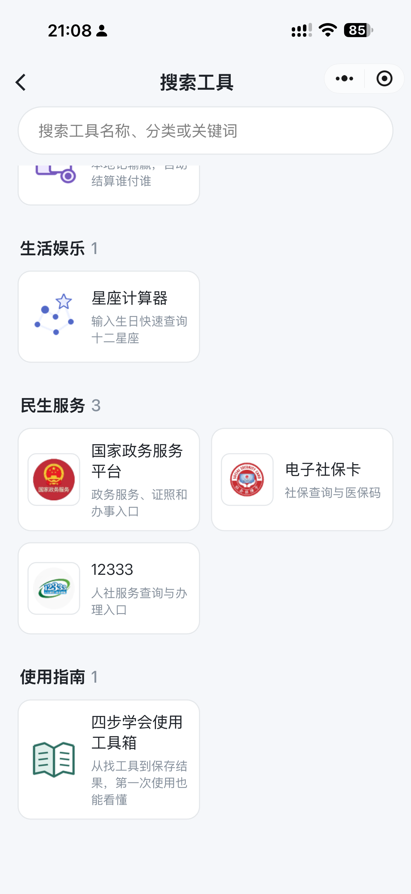

# 全能工具箱

日常要用的小工具，这里基本齐了。微信小程序，本地处理图片和视频，不上传业务服务器。

<p align="center">
  
</p>
<p align="center"><b>微信扫一扫，即可打开小程序</b></p>

## 亮点

- **本地处理**：图片排版、压缩、拼接、改尺寸、加水印、视频压缩均在设备上完成，结果直接保存到相册。
- **隐私优先**：证件排版不上传业务服务器；选图会走微信内容安全检测，检测后立即删除。
- **工具齐全**：图片、视频、房贷工资、社保入口、生活健康、棋牌记账等，搜索即可找到。
- **开箱即用**：首页热门入口 + 分类搜索，四步指南覆盖从找工具到保存结果。

## 界面预览

首页支持搜索和分类快捷入口，热门工具与精选专题一眼能看到。

<p align="center">
  
  
</p>

## 部分工具

证件材料复印排版：身份证正反面或通用材料一键排成 A4，生成本地 JPG / 单页 PDF，可选用途水印。

图片压缩：按质量或目标体积压缩，支持保持原格式或转为 JPG / PNG，尺寸可按比例缩小或自定义像素。

<p align="center">
  
  
</p>

## 工具目录

按分类浏览，也可搜索工具名称、分类或关键词。

<p align="center">
  
  
  
  
</p>

| 分类 | 工具 |
| --- | --- |
| 图片处理 | 证件材料复印排版、拼豆、图片压缩、长图拼接、图片改尺寸、九宫格切图、二维码生成、图片加水印、照片隐私清理 |
| 视频处理 | 视频压缩 |
| 生活计算 | 房贷计算器、工资计算器、养老金估算器、退休年龄计算器、比价计算器、日期间隔计算器、亲戚关系计算器、商品保质期计算器 |
| 日常计算 | 单位换算、校准尺子 |
| 生活健康 | BMI 计算、基础代谢率 |
| 理财 / 经营 | 复利 / 定投计算器、餐饮投资计算器 |
| 生活娱乐 | 星座计算器、选择困难助手、打牌记账 |
| 民生服务 | 电子社保卡、12333、国家政务服务平台 |

## 技术栈

- [Taro 4](https://taro.jd.com/) + React + TypeScript
- 微信小程序 Skyline 渲染、Glass-easel 组件框架
- 微信云开发：图片内容安全检测（检测后立即删除）
- 主包仅保留入口页，工具页按分包按需加载

## 目录结构

```text
tool-kits/
├── cloudfunctions/              # 微信云函数
│   └── imageSecurityCheck/      # 图片内容安全检测（检测后立即删除）
├── config/                      # Taro 编译配置（dev / prod）
├── images/                      # README 用小程序码与运行截图
├── scripts/                     # 环境同步、分包体积检查、工具图标生成
├── src/
│   ├── app.ts                   # 应用入口
│   ├── app.config.ts            # 页面与分包配置
│   ├── assets/                  # 静态资源（工具图标等）
│   ├── components/              # 全局组件
│   │   ├── NavigationBar/
│   │   ├── PrivacyAuthorization/
│   │   ├── SectionHeader/
│   │   └── ToolCard/
│   ├── config/                  # 云函数名等（云环境 ID 来自 .env）
│   ├── pages/                   # 主包：首页、搜索、占位页
│   ├── packages/
│   │   ├── document-copy/       # 证件材料复印排版分包
│   │   └── tools/               # 其余工具分包（压缩、房贷、拼豆等）
│   ├── services/                # 内容安全检测、本地压缩
│   ├── styles/                  # 全局样式 token
│   ├── test/                    # 覆盖率与目录测试
│   └── utils/                   # 工具目录、选图、导航等
├── types/                       # 全局 TypeScript 声明
├── .env.example                 # 环境变量示例（复制为 .env 后填写）
├── babel.config.js
├── package.json
├── project.config.json          # 微信开发者工具项目配置
├── tsconfig.json
├── vitest.config.mts
└── README.md
```

构建产物在 `dist/`，不纳入版本库；微信开发者工具打开本目录，`miniprogramRoot` 指向 `dist/`。

## 开发

先复制环境变量示例，填入自己的微信小程序 AppID 和云开发环境 ID：

```bash
cp .env.example .env   # Windows：copy .env.example .env
```

`.env` 说明：

- `TARO_APP_ID`：微信小程序 AppID，构建时写入微信开发者工具配置
- `TARO_APP_CLOUD_ENV_ID`：微信云开发环境 ID，用于图片内容安全检测

**不要提交 `.env`。** 该文件已加入 `.gitignore`，仓库只保留 `.env.example`。

```bash
nvm use   # Node 22
pnpm install
pnpm typecheck
pnpm build:weapp
pnpm dev:weapp
```

部署图片内容安全云函数（macOS 示例，`--env` 填 `.env` 里的 `TARO_APP_CLOUD_ENV_ID`）：

```bash
/Applications/wechatwebdevtools.app/Contents/MacOS/cli cloud functions deploy \
  --env <TARO_APP_CLOUD_ENV_ID> \
  --names imageSecurityCheck \
  --remote-npm-install \
  --project "$PWD"
```

微信开发者工具打开本目录（`miniprogramRoot` → `dist/`），开启 Skyline 渲染调试。

首次导入开发者工具前必须先执行 `pnpm build:weapp`。如果开发者工具在 `dist/app.json` 生成前已经打开并提示文件不存在，构建完成后选择「项目 → 重新打开此项目」；普通「编译」可能仍会保留旧的启动错误。

项目启用了 `__usePrivacyCheck__`。发布前需在微信公众平台的隐私保护指引中声明实际使用的图片、视频选择与相册保存能力。图片会临时上传到微信云环境执行内容安全检测，检测后立即删除；图片加工和视频处理仍在本地完成，结果仅提供保存到相册。

## 社区

感谢 [LINUX DO](https://linux.do/) 开源社区提供交流与分享平台。

## 公众号

<p align="center">
  
</p>
<p align="center"><b>微信扫描上方二维码，关注公众号 程序员小袁</b></p>
<p align="center">编程干货 · 开发笔记 · AI 工具</p>
